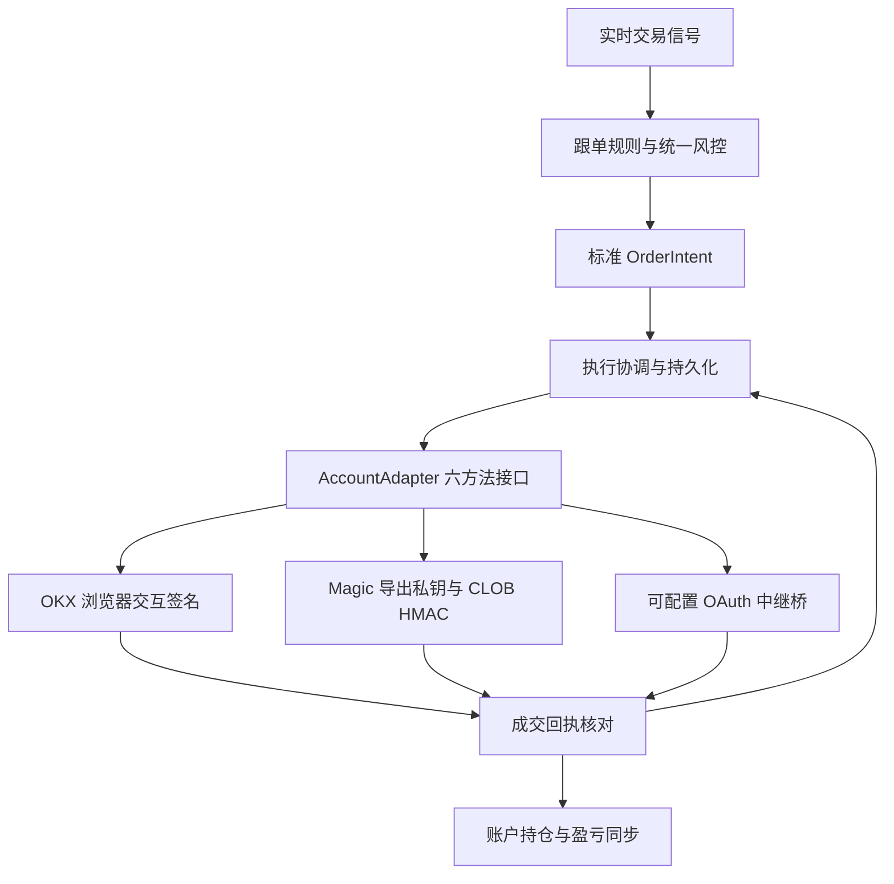

# 账户接入与执行契约

接口定义见 `backend/accounts/contracts.py`：`check_connection`、`read_account`、`submit_order`、`get_receipt`、`cancel_order`、`sync_pnl`。策略只生成订单意图，不判断登录方式。钱包配置拥有独立 ID、显示名、资金地址和凭证；订单绑定创建时账户，切换账户不得改变既有订单的所属账户。

## 能力差异

OKX 使用 EIP-1193 注入 provider，在 Polygon 137 请求 EIP-712 签名；不读取私钥。每笔委托由用户确认，离线不得静默下单。撤单确认签名是本工具的授权步骤；交易所撤单请求本身使用 L2 HMAC。

Magic 导出密钥通道使用标准 EVM 签名和官方 CLOB HMAC。Google 登录本身不能确定资金钱包或签名类型，需按实际账户填写 EOA / proxy / safe 与 Funder。

OAuth 通道保留用户可配置的中继 URL（包含端口）。没有已确认的官方 OAuth 下单契约，不能把任意 Google token 当作 CLOB 凭证。本工具定义兼容桥契约，只有中继实现并通过能力/账户校验后才能启用。不得声称仅填写 URL 即已接通官方服务。

## 中继桥 v1

全部请求 `Authorization: Bearer <本地加密 token>`；不跟随重定向。`GET /v1/account` 返回 `protocol: polymarket-account-bridge/1`、`address`、`chain_id:137`、`authenticated`、`balance_usdc`、`allowance_ready`、`positions`。`POST /v1/orders` 接受标准 OrderIntent，使用意图 ID 作为幂等键；返回 Submission。`GET /v1/orders/{intent_id}` 返回 Receipt，`DELETE` 同一路径撤单。回执必须保留 account_id 和 intent_id。中继必须验证自身会话与实际交易账户对应关系。

## 状态与安全

签名前保存意图；发送前保存 SUBMITTING；网络异常保持 PENDING，禁止盲目重发。读取回执允许退避重试；缺少订单号时明确告警并要求交易所核对。成交只采用交易所回执，不以信号价格伪造成交。Windows DPAPI 按当前系统用户加密凭证，禁止明文降级；公开账户配置与敏感凭证分开存储。

旧 Python CLOB SDK 仅复用 L1/L2 认证与查询传输。`clob_signing.py` 替换其过时订单构建器：根据实际盘口 `version` / `neg_risk` 选择当前 CTF domain v2 或 Protocol V2 domain v3；使用官方新 Order 字段（timestamp、metadata、builder），拒绝未知协议与 Deposit Wallet 类型 3。EOA/Proxy/Safe 签名有本地签名与格式测试，仍需用户账户实际成交验收。参考：https://docs.polymarket.com/getting-started/api 与 https://docs.polymarket.com/trading/place-orders 。

验收分为无资金自动测试与真实账户验收。没有用户插件、有效凭证及真实成交时，只能报告模拟测试通过，不能声称实盘链路验收完成。
